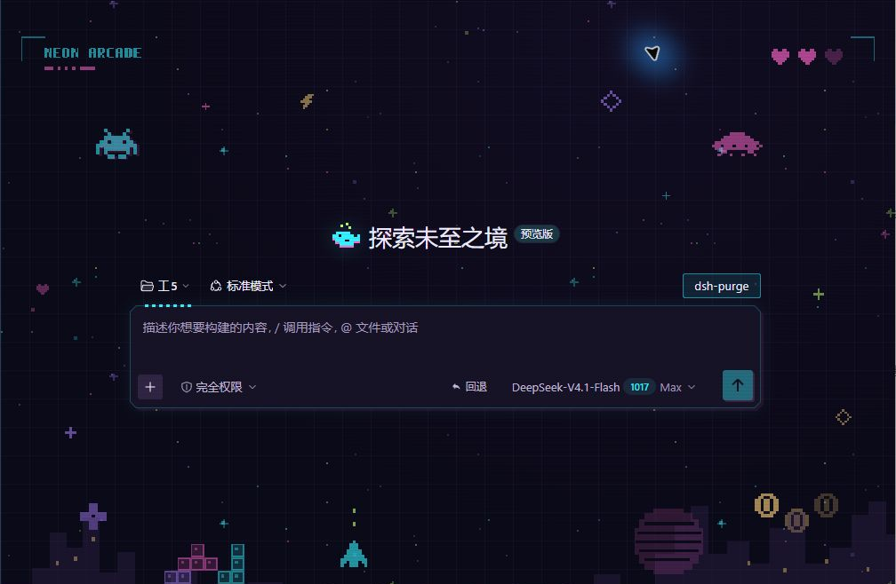
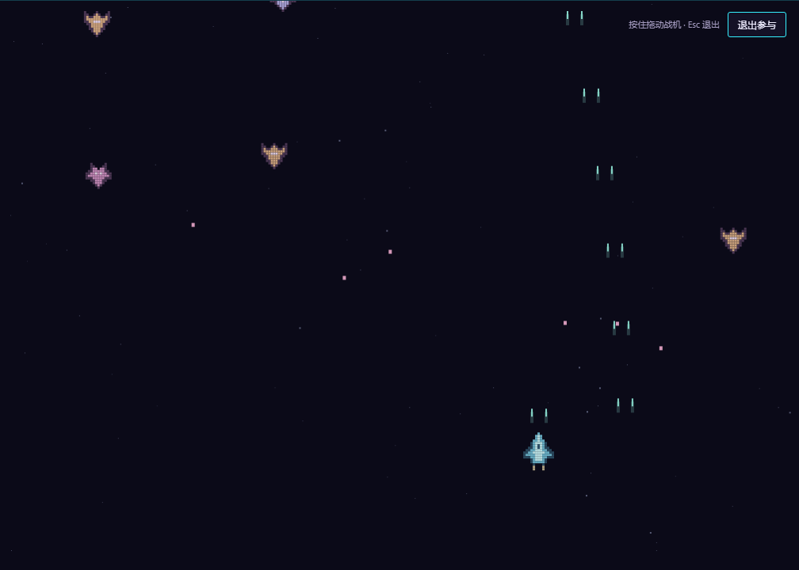
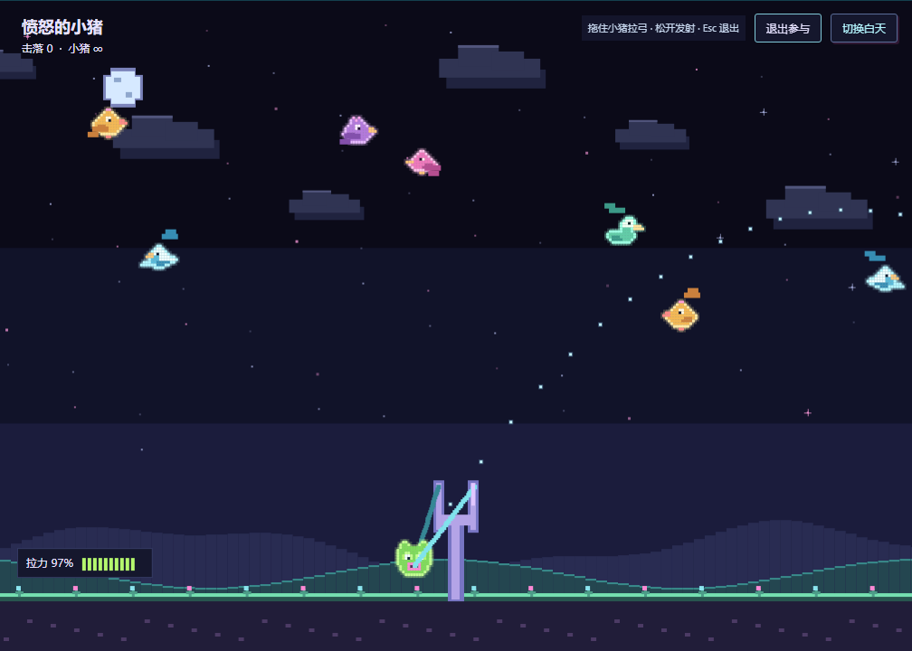
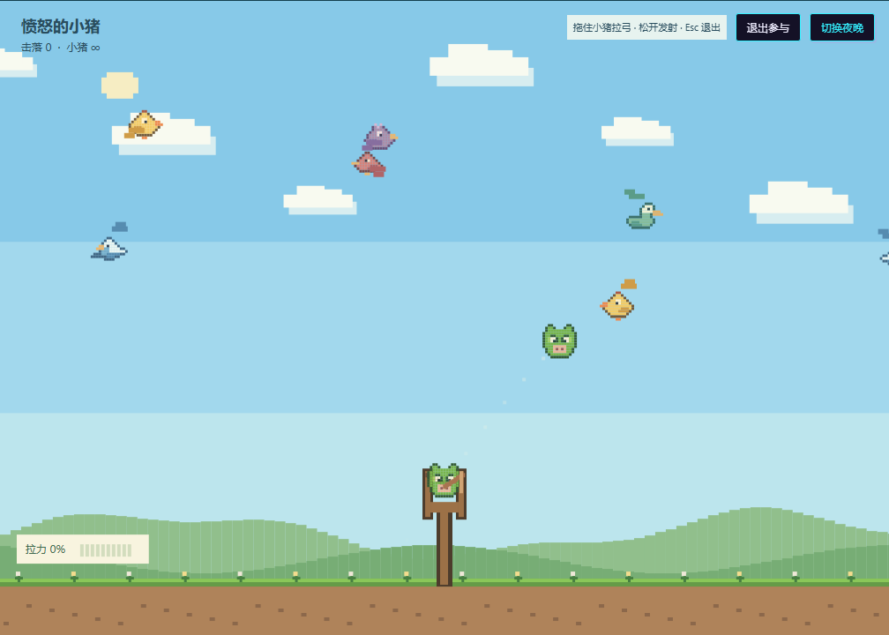

# NEON ARCADE · 霓虹像素电玩

**1.4.2：更新兼容性声明，Windows 桌面端 0.2.1-rc.1～0.2.1-rc.5 均已验证成功。** 包含「愤怒的小猪」与昼夜切换，默认霓虹夜晚。从下方 Releases 下载预构建安装包，支持离线安装。

为 **DeepSeek Harness 桌面端**提供霓虹像素主题、街机背景与可参与的小游戏。已验证兼容 **Windows / Harness 0.2.1-rc.1～0.2.1-rc.5**；独立 Web 客户端不会启用此主题。

深紫黑底色、电光青与品红描边、原创像素精灵、星空、城市剪影和像素鲸鱼。正文、中文、代码与终端保留原有字体。支持深浅色外观，所有装饰均可关闭。



*主题预览来自桌面端；两款小游戏预览来自使用同一插件构建的离屏测试画布。*

## 安装

1. 在本仓库的 [Releases](https://github.com/Time-233/dsh-theme-neon-arcade/releases/latest) 页面下载 **[`dsh-theme-neon-arcade.tgz`](https://github.com/Time-233/dsh-theme-neon-arcade/releases/latest/download/dsh-theme-neon-arcade.tgz)**。使用预构建插件包，不需要自行构建或安装 Node.js。
2. 在 **DeepSeek Harness 桌面端 → 插件 → 添加插件** 中填入下载文件的**完整绝对路径**，安装后启用。例如 Windows 下载目录中的 `C:\Users\你的用户名\Downloads\dsh-theme-neon-arcade.tgz`。
3. 若应用提示刷新，点击「刷新页面」。在「更多 → 设置 → 通用设置 → NEON ARCADE」调整效果。

也可下载源码 ZIP，完整解压后用同一入口安装包含 `package.json` 的目录。仓库包含已构建的 `client.js`；安装时不需要构建脚本，也没有外部运行依赖。

升级时在插件管理中安装新版包。偏好设置保存在当前客户端中，升级保留原有开关。禁用或卸载后撤销主题覆盖、样式、插槽、游戏画布和事件监听。

## 使用

| 功能 | 操作与行为 |
| --- | --- |
| 主题总开关 | 左下角 `NEON ARCADE` / `NEON / OFF` 按钮，或通用设置中的主题开关。 |
| 辉光 / 网格 / 像素点缀 | 通用设置中的独立开关。像素精灵集中于画布四周，实际聊天时自动淡化。 |
| CRT 扫描线 | 默认关闭；开启后为一条低亮度灰蓝细线，约 18 秒从上向下循环，不平铺密集横纹。 |
| 像素空战背景 | 默认关闭；开启后我方自动巡航和双发射击，敌机持续生成并射击，子弹有碰撞判定。 |
| 游戏选择 | 在通用设置中开启「启用小游戏背景」，通过「游戏选择」切换「像素空战」或「愤怒的小猪」。同一时间运行一个游戏。 |
| 参与游戏 | 开启空战后，点击画布右上角「参与游戏」，按住鼠标左键拖动战机。松开后停留并继续自动射击。 |
| 退出参与 | 点击「退出参与」或按 Esc，恢复聊天焦点和自动巡航。关闭游戏立即恢复原背景。 |

我方中弹约 0.85 秒后复活，次数无限，并获得短暂无敌。参与期间画布临时作为游戏操作区；切换会话、离开游戏焦点、隐藏窗口会退出参与。参与状态不跨会话保存，观赏状态不接管鼠标和键盘。



## 愤怒的小猪

在「更多 → 设置 → 通用设置 → NEON ARCADE」开启 **启用小游戏背景**，将 **游戏选择** 改为 **愤怒的小猪**，再点击画布右上角 **参与游戏**。

- **默认霓虹夜晚。** 深紫星空、像素月亮、青紫草地、明亮的弹弓与瞄准线；五种小鸟和小猪采用清晰的亮色像素轮廓，夜间飞行、坠落与碎散均可辨认。
- 画布右上角 **切换白天 / 切换夜晚** 按钮可随时切换。白天为蓝天、白云和草地；切换保留当前分数、飞行中的角色及参与状态。选择保存在本机，重新进入或刷新后沿用。
- 草地、土层与底部弹弓均以像素风绘制，天空持续有五种不同外形的小鸟从左右飞行、折返。
- **按住弹弓上的小猪向下或侧后拉动，松开发射。** 拉得越远，发射速度越大；拉力有上限。拖拽时显示按同一重力与初速度计算的抛物线瞄准虚线。
- 小猪无限装填，约 0.34 秒补充下一只。命中小鸟时，小猪立即化成绿色粒子；小鸟先在重力下翻滚坠落，到草地后再碎成对应颜色的像素粒子。
- 未命中的小猪落地或离开画面后清理；显示击落数，没有游戏结束或弹药购买。
- **退出参与 / Esc** 恢复聊天；取消指针、失焦、隐藏窗口和切换游戏会取消拉弓，不会误发射。关闭小游戏背景恢复原主题场景。





旧版游戏偏好会迁移为「像素空战」，已有主题与开关选择保留。新游戏模式保存在本机，参与状态不持久化。

## 兼容性与实现

- 已验证：Windows 桌面端 **0.2.1-rc.1、0.2.1-rc.2、0.2.1-rc.3、0.2.1-rc.4、0.2.1-rc.5**。扩展范围依据作者于 2026-11-01 确认的实际验证结果，已同步至 `package.json` 的兼容性声明。尚未验证其他系统和范围外的 Harness 版本。
- 使用原生 `dsh.bundle` / Cordis 声明、`theme.overrideTokens()` 与界面插槽；不修改应用安装文件。
- `dsh.client.platform: web` 是桌面内嵌渲染器使用的清单格式。运行时检查 `shortcuts.runtime === 'desktop'`，独立 Web 客户端直接退出。
- 基础配色提供 105 个深浅色语义参数。局部框架装饰适配了当前 Harness 的样式类名；应用更新若改变这些类名，部分装饰可能需要适配。
- 原创战机、子弹、星空及爆散由代码绘制，不使用其他游戏的图片、音效或素材。无声音、排行榜或联网功能。
- 游戏按 30 帧目标绘制，对敌机、子弹、粒子设定数量上限。窗口隐藏时暂停；关闭游戏或主题后释放动画帧、观察器和监听。
- 字体与画面内嵌，可离线使用。不读取会话文本，不注册模型工具或全局键鼠监听。

## 开发与检查

需要 Node.js 22 或更高版本，无需安装第三方依赖：

```sh
npm run build
npm test
npm run check
npm run release:pack
```

`release:pack` 在 `dist/` 生成固定名称的预构建 `.tgz` 和 `SHA256SUMS.txt`。构建可重复；仓库同时提交源文件和 `client.js`。`npm pack` 前会重新构建，普通安装没有构建钩子。

测试覆盖 Web 隔离、启停清理、偏好迁移、基础文字对比度、持续交火、碰撞、无限复活、实体上限、尺寸适配、拖动控制和参与状态清理。包检查还会校验实际打包清单、许可证与内嵌构建的一致性。

主要源文件：`src/client.js`（原生插槽与设置）、`src/theme.css`（界面样式）、`src/palette.mjs`（配色）、`src/arcade-art.mjs`（SVG 场景）、`src/air-battle.mjs`（游戏与拖动逻辑）。

`src/pig-sling.mjs` 提供弹弓物理、瞄准轨迹、命中及坠落判定、粒子与原创像素昼夜场景。游戏共用参与控制和生命周期；26 项自动测试覆盖两种游戏、模式迁移和夜间精灵可辨识性，另有离屏 Chromium 的拖拽、发射、昼夜切换及偏好保存验证。

发布与收录流程见 [docs/RELEASING.md](docs/RELEASING.md)，版本变化见 [CHANGELOG.md](CHANGELOG.md)。

## English

NEON ARCADE is a neon pixel theme for **DeepSeek Harness desktop**, verified on Windows with Harness **0.2.1-rc.1 through 0.2.1-rc.5**. The expanded range is based on the author's confirmation of successful testing on 2026-11-01 and is declared in `package.json`. It offers dark/light palettes, original pixel scenery, optional glow/grid, a subtle single CRT scan line, and an optional air-battle background.

Download **`dsh-theme-neon-arcade.tgz`** from [Releases](https://github.com/Time-233/dsh-theme-neon-arcade/releases/latest). In the desktop app, open **Plugins → Add plugin**, enter the downloaded file's absolute path, then install and enable it. The package is prebuilt and has no external runtime dependencies. Configure it under **Settings → General → NEON ARCADE**.

Enable the air-battle background and click **参与游戏** (Join game). Hold the left mouse button and drag to move your plane; firing is automatic and respawns are unlimited. Click **退出参与** (Leave game) or press Esc to return to chat and autopilot. Turning the game off restores the original scene. The standalone Web client is untouched.

Version 1.4.1 also includes **愤怒的小猪** (Angry Pigs). Select it under **游戏选择**, join, pull the loaded pig down or back, and release to launch. It offers unlimited pigs, gravity-matched dotted aiming, five flying bird silhouettes, immediate pig fragments and birds that fall before shattering at the ground. The scene defaults to neon night; use **切换白天 / 切换夜晚** to switch and save the setting without resetting gameplay.

## 许可 / License

代码使用 [MIT](LICENSE) 许可。Silkscreen 字体来自 [Google Fonts 官方仓库](https://github.com/google/fonts/tree/main/ofl/silkscreen)，由 The Silkscreen Project Authors 提供，使用 [SIL Open Font License 1.1](assets/Silkscreen-OFL.txt)；字体文件未修改。
